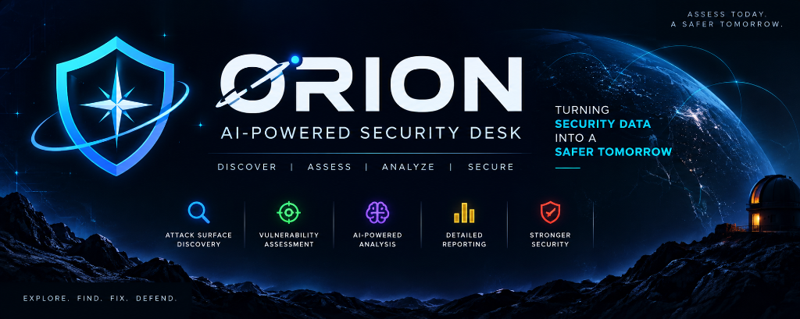
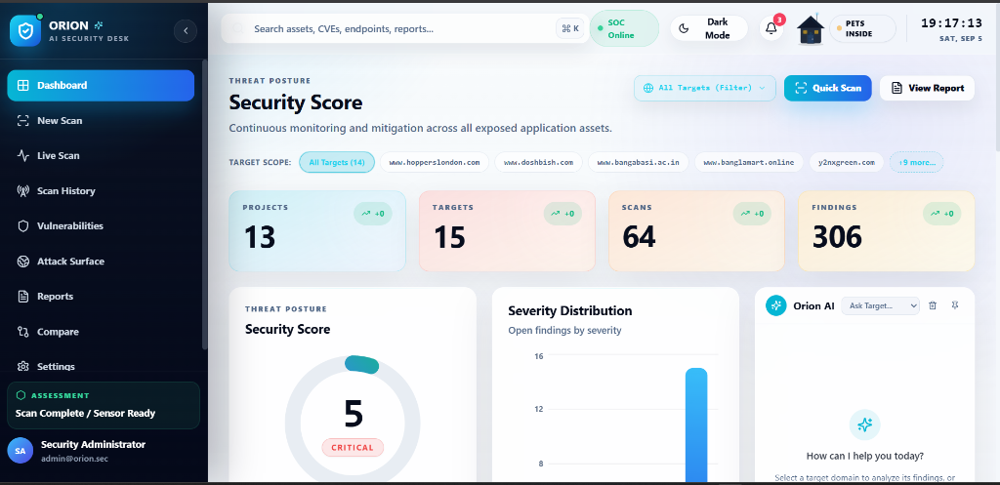
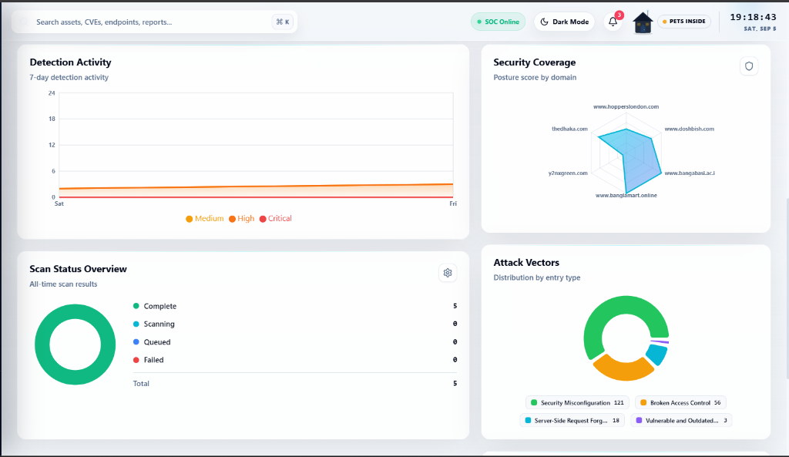
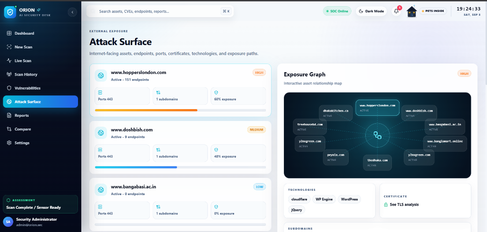
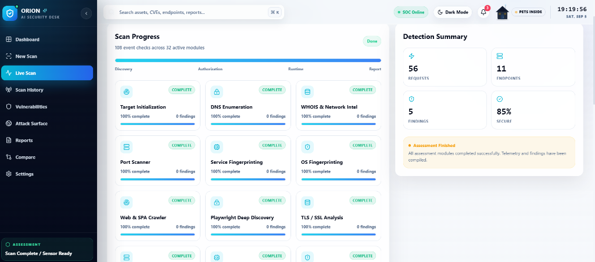
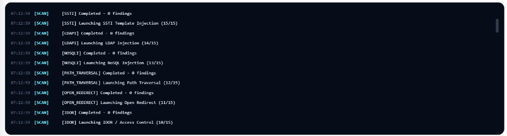
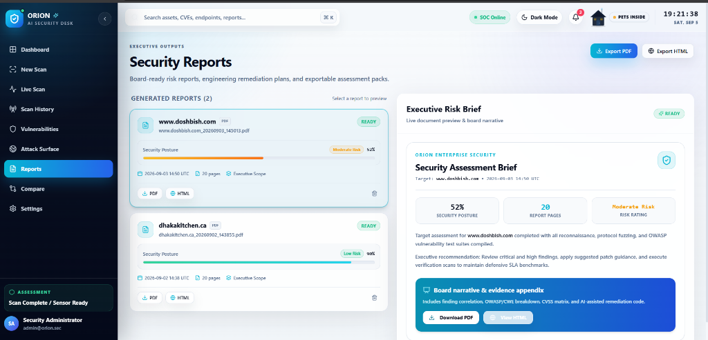
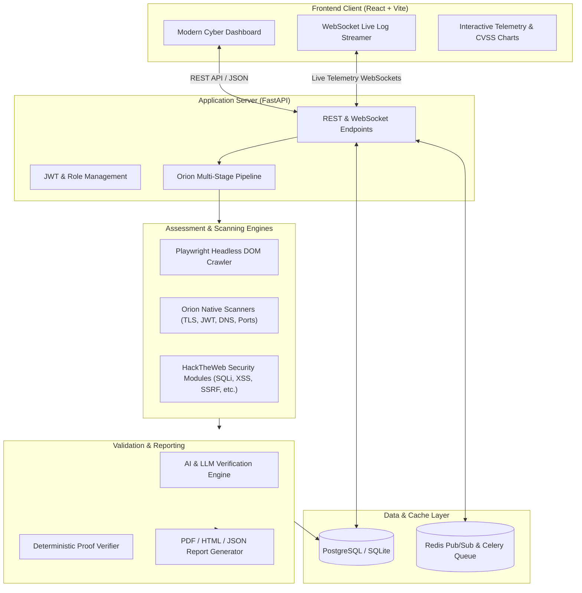

<div align="center">

<!-- HERO BANNER IMAGE PLACEHOLDER -->
<!-- Drop your project banner at: docs/images/banner.png -->
<p align="center">
  
</p>

# 🌌 ORION
### Next-Generation Automated Web Security Assessment & AI Verification Platform

An AI-powered web application security assessment platform for automated vulnerability detection, intelligent proof verification, real-time scan telemetry, and comprehensive executive reporting.

<p align="center">
  <a href="LICENSE"></a>
  
  
  
  
  
  
  
</p>

<p align="center">
  <a href="#-authorized-security-testing-only">Security Policy</a> •
  <a href="#-visual-showcase">Screenshots</a> •
  <a href="#-key-capabilities">Features</a> •
  <a href="#-architecture">Architecture</a> •
  <a href="#-quick-start-guide">Quick Start</a> •
  <a href="#-tech-stack">Tech Stack</a>
</p>

</div>

---

## ⚠️ Authorized Security Testing Only

> [!IMPORTANT]
> **ORION is intended exclusively for authorized penetration testing, defensive evaluations, and security research within controlled or explicitly permitted environments.**

- **Explicit Authorization Required**: You must only scan systems, networks, applications, and endpoints that you own or have received formal, written authorization to assess.
- **No Malicious Use**: Scanning or testing third-party systems without prior authorization is illegal and prohibited.
- **User Responsibility**: Users assume full responsibility for complying with all applicable local, national, and international laws (including the US CFAA, UK Computer Misuse Act, and GDPR). The author and contributors do not authorize, condone, or encourage unauthorized or unlawful use.

For detailed guidelines, scope restrictions, and vulnerability reporting procedures, see:
- 🛡️ [Security Policy](SECURITY.md)
- ⚖️ [License](LICENSE)
- 📜 [Third-Party Notices](THIRD_PARTY_NOTICES.md)

---

## 📸 Visual Showcase

### 1. Operations & Threat Intelligence Dashboard
Centralized security operations center displaying overall security scores, target scopes, active scan statuses, severity distributions, and Orion AI interactive assistant.

<p align="center">
  
</p>

---

### 2. Detection Analytics & Attack Vectors
Comprehensive vulnerability analytics featuring 7-day detection activity trends, multi-dimensional security coverage radar charts, and categorized attack vectors.

<p align="center">
  
</p>

---

### 3. External Exposure & Interactive Attack Surface Graph
Discovery and mapping of internet-facing assets, subdomains, open ports, certificates, detected technologies, and interactive node relationship exposure graphs.

<p align="center">
  
</p>

---

### 4. Real-Time Live Scan Telemetry
Multi-module scanning progression monitor tracking 32 active assessment checks (DNS, WHOIS, Port Scanner, Service Fingerprinting, Playwright Deep Discovery, and TLS analysis) alongside real-time request counts and security posture scores.

<p align="center">
  
</p>

---

### 5. Live Event Stream & Terminal Console
High-speed terminal log streaming directly via WebSockets, displaying real-time scanner activities, fuzzing payloads, and module completion events.

<p align="center">
  
</p>

---

### 6. Executive Security Reporting & PDF Exports
Production of board-ready executive security briefs, risk summaries, OWASP/CWE correlations, CVSS scoring, and one-click PDF and HTML report exports.

<p align="center">
  
</p>

---

## 🚀 Key Capabilities

| Capability | Description |
|---|---|
| **Multi-Stage Orchestrator** | Automated pipeline encompassing passive DNS/Whois recon, headless Playwright browser crawling, vulnerability scanners, and report finalization. |
| **Deep Web Crawling** | Hybrid crawler utilizing static HTML parsing and dynamic DOM rendering via headless Chromium to discover SPAs, forms, and hidden endpoints. |
| **Broad Vulnerability Coverage** | Detection modules for SQL Injection, Cross-Site Scripting (XSS), CSRF, CORS misconfigurations, IDOR, SSRF, SSTI, Path Traversal, and JWT flaws. |
| **AI Proof Verification** | Multi-engine verification layer utilizing LLMs and deterministic rule-guards to validate exploit payloads and filter out false-positive noise. |
| **Reactive Telemetry** | Full-duplex WebSocket communication streaming live terminal output, module progress percentages, and instant finding notifications. |
| **Executive Reports** | Automated generation of styled PDF, HTML, and JSON reports with executive summaries, CVSS v3.1 scoring, and developer remediation guides. |

---

## 🏗️ Architecture



---

## 🛠️ Quick Start Guide

### 1. Prerequisites
- **Python 3.10+**
- **Node.js 18+** & npm
- *(Optional)* **Redis** & **PostgreSQL** (SQLite supported out of the box for local development)

---

### 2. Backend Setup

1. **Clone the repository:**
   ```bash
   git clone https://github.com/divyanshsingh25/Orion.git
   cd Orion
   ```

2. **Create and activate a Python virtual environment:**
   ```bash
   python -m venv .venv

   # Windows (PowerShell):
   .\.venv\Scripts\Activate.ps1
   # Windows (CMD):
   .\.venv\Scripts\activate.bat
   # Linux / macOS:
   source .venv/bin/activate
   ```

3. **Install dependencies:**
   ```bash
   pip install -r requirements.txt
   ```

4. **Install Playwright browsers (for dynamic web crawling):**
   ```bash
   playwright install chromium
   ```

5. **Configure environment variables:**
   ```bash
   # Windows
   copy backend\.env.example backend\.env
   # Linux / macOS
   cp backend/.env.example backend/.env
   ```
   *Edit `backend/.env` to configure your API keys (e.g. OpenAI/LLM keys, secret keys, or database URLs).*

6. **Start the backend server:**
   ```bash
   cd backend
   python -m uvicorn app.main:app --reload --port 8123
   ```
   - API Docs: `http://localhost:8123/docs`
   - Health Check: `http://localhost:8123/api/v1/health`

---

### 3. Frontend Setup

1. **Navigate to the frontend folder:**
   ```bash
   cd frontend
   ```

2. **Install Node dependencies:**
   ```bash
   npm install
   ```

3. **Start the development server:**
   ```bash
   npm run dev
   ```
   Open `http://localhost:5173` in your browser.

---

## 🧰 Tech Stack

| Layer | Technologies |
|---|---|
| **Frontend** | React 18, TypeScript, Vite, Tailwind CSS, Lucide Icons, Recharts |
| **Backend** | FastAPI, Python 3.10+, Uvicorn, WebSockets, Pydantic v2 |
| **Database & ORM** | PostgreSQL, SQLite (Local Dev), SQLAlchemy 2.0 (Async), Alembic |
| **Task Queue & Cache** | Celery, Redis |
| **Scanning & Crawling** | Playwright (Chromium), HTTPX, Aiohttp, HackTheWeb Security Engines |
| **Reporting & Export** | ReportLab (PDF), HTML5 templates, JSON |

---

## 📁 Repository Structure

```
Orion/
├── docs/
│   └── images/              # Dedicated directory for README screenshots & banners
├── backend/
│   ├── app/                 # FastAPI application core, routers, models, schemas
│   │   ├── scanner/         # Multi-stage orchestrator, safety layers, crawlers
│   │   ├── services/        # Scan execution, LLM verification, report services
│   │   └── database/        # Async database engine & migrations
│   ├── requirements.txt     # Backend Python dependencies
│   └── start.bat            # Quick start batch script for Windows
├── frontend/
│   ├── src/                 # React components, pages, dashboard, charts
│   └── package.json         # Frontend package configuration
├── hacktheweb-main/         # Integrated security analysis & vulnerability modules
├── requirements.txt         # Root Python requirements for easy deployment
├── SECURITY.md              # Responsible disclosure & authorized testing policy
├── THIRD_PARTY_NOTICES.md   # Third-party notices and upstream attributions
└── LICENSE                  # MIT License
```

---

## ⚖️ License & Attribution

- **License**: ORION is distributed under the [MIT License](LICENSE). Copyright (c) 2026 Divyansh Singh.
- **Third-Party Attribution**: Integrates components from [HackTheWeb](https://github.com/yashab-cyber/hacktheweb) under the MIT License. See [THIRD_PARTY_NOTICES.md](THIRD_PARTY_NOTICES.md) for full licensing details and code provenance.
